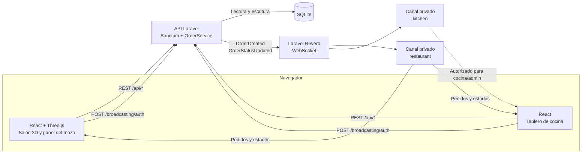
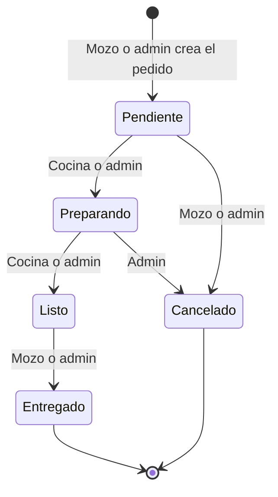

<p align="center">
  
</p>

<h1 align="center">Don Gato</h1>

<p align="center">
  Sistema de gestión de pedidos para restaurante con salón 3D interactivo en tiempo real.
</p>

<p align="center">
  
  
  
  
  
  
</p>

## Capturas

La galería se completará con las imágenes alojadas en `docs/screenshots/`.

<!-- TODO: agregar docs/screenshots/salon.png -->
<!-- TODO: agregar docs/screenshots/panel-mozo.png -->
<!-- TODO: agregar docs/screenshots/cocina.png -->
<!-- TODO: agregar docs/screenshots/login.png -->
<!-- TODO: agregar docs/screenshots/celular.png -->
<!-- TODO: agregar docs/screenshots/demo.gif -->

## ¿Qué es?

Don Gato resuelve la coordinación entre el salón y la cocina de un restaurante. El mozo selecciona una mesa en un plano 3D, arma el pedido con la carta y lo envía; la cocina lo recibe al instante por WebSocket, lo avanza a preparación y lo marca como listo. El mozo cierra el circuito marcando la entrega. Cada cambio se refleja en el salón y en el tablero sin recargar la página.

## Características

- Salón 3D con ocho mesas seleccionables, color por estado (`libre`, `pendiente`, `preparando`, `listo`) e indicador visual para pedidos listos. Si WebGL no está disponible, se muestra una vista de lista con el mismo panel de pedidos.
- Carta obtenida desde SQLite, organizada en pizzas, hamburguesas y bebidas, con precios, descripciones y filtrado de productos no disponibles.
- Pedidos en vivo con Laravel Reverb: altas, cambios de estado y actualización del estado de la mesa mediante canales privados.
- Tablero de cocina con columnas para pendientes, en preparación y listos, tiempo transcurrido, aviso de demora y resaltado de pedidos nuevos.
- Roles `mozo`, `cocina` y `admin`, con autorización por transición en el backend y vistas diferenciadas en el frontend.
- Animaciones ambientales: gatos que recorren el salón, clientes sentados según los pedidos activos y mozos que retiran pedidos listos.
- Interfaz responsive con puntos de corte en 600 y 1024 px, controles táctiles, adaptación a modo apaisado y soporte para `prefers-reduced-motion`.
- Calidad gráfica adaptable (`alta`, `media`, `baja`) según ancho, densidad de píxeles y núcleos disponibles, con descenso automático por rendimiento y opción para desactivar animaciones.

## Inicio rápido con Docker

### Requisitos

- Docker Desktop con Docker Compose.
- No es necesario instalar PHP, Composer, Node.js ni SQLite por separado.

### Puesta en marcha

```bash
git clone https://github.com/Fernando-Nieva/emisor-receptor.git
cd emisor-receptor
docker compose up --build
```

La primera ejecución construye las imágenes, aplica las migraciones y ejecuta los seeders. La aplicación queda disponible en:

| Servicio | URL |
| -------- | --- |
| Aplicación | <http://localhost:5173> |
| API Laravel | <http://localhost:8000> |
| Reverb | `ws://localhost:8080` |

Los valores incluidos en `docker-compose.yml` permiten iniciar la demo sin crear un archivo `.env`. Para personalizar claves o puertos, copiá `.env.docker.example` a `.env` y reiniciá con `docker compose up --build`.

### Usuarios de prueba

| Rol | Correo | Contraseña |
| --- | --- | --- |
| Mozo | `mozo@example.com` | `password` |
| Mozo | `mozo2@example.com` | `password` |
| Cocina | `cocina@example.com` | `password` |
| Admin | `admin@example.com` | `password` |

> Los usuarios, contraseñas y claves incluidas son exclusivamente de demostración. No deben reutilizarse en un entorno público.

## Cómo usarlo

1. **Mozo:** iniciá sesión, elegí una mesa en el salón 3D, agregá productos y notas, y enviá el pedido. El pedido se crea en estado `pendiente`.
2. **Cocina o admin:** ingresá a **Cocina**, abrí el pedido pendiente y usá **Empezar**; después, **Marcar listo**. La cocina no puede cancelar pedidos ni entregarlos.
3. **Mozo o admin:** cuando el pedido esté `listo`, abrí la mesa y usá **Marcar como entregado**. Un pedido `pendiente` también puede cancelarse desde el panel del mozo.

El rol `admin` puede entrar tanto al salón como a la cocina. El backend le permite ejecutar cualquier transición válida; la interfaz no expone la cancelación de un pedido que ya está en `preparando`.

### Permisos por rol y transición

| Transición | Mozo | Cocina | Admin |
| --- | :---: | :---: | :---: |
| `pendiente` → `preparando` | No | Sí | Sí |
| `pendiente` → `cancelado` | Sí | No | Sí |
| `preparando` → `listo` | No | Sí | Sí |
| `preparando` → `cancelado` | No | No | Sí |
| `listo` → `entregado` | Sí | No | Sí |

Las transiciones no listadas se rechazan con `422`. Una transición válida ejecutada por un rol sin permiso responde `403`. La autorización se implementa en `backend/app/Policies/OrderPolicy.php`, y las transiciones permitidas en `backend/app/Enums/OrderStatus.php`.

## Arquitectura

El frontend consume la API REST para el estado inicial y las acciones, y mantiene la actualización en vivo mediante Laravel Reverb. La API persiste en SQLite y publica los eventos de pedidos en los canales privados `restaurant` y `kitchen`.



La SPA se suscribe al canal `restaurant` desde `useOrders`; el canal `kitchen` está autorizado para `cocina` y `admin` en `routes/channels.php`. La autorización de canales privados se resuelve contra `POST /broadcasting/auth` con el token de Sanctum.

### Ciclo de vida de un pedido



`entregado` y `cancelado` son estados finales. El enum `OrderStatus` y la política de transición impiden movimientos fuera de este flujo.

## Stack tecnológico

| Tecnología | Versión declarada | Uso |
| --- | --- | --- |
| PHP | `^8.3` | Runtime de la API y los tests. La imagen Docker usa PHP 8.5. |
| Laravel | `^13.17` | Framework HTTP, Eloquent, validación y broadcasting. |
| Laravel Sanctum | `^4.0` | Autenticación con tokens Bearer. |
| Laravel Reverb | `^1.0` | Servidor WebSocket. |
| SQLite | PDO SQLite | Persistencia local y de la demo Docker. |
| React | `^19.3.1` | Interfaz del salón y del tablero. |
| React Router | `^7.18.4` | Rutas protegidas por sesión y rol. |
| Three.js | `^0.186.1` | Escena 3D del restaurante. |
| React Three Fiber | `^9.8.2` | Renderizado de la escena con React. |
| Drei | `^10.7.9` | Utilidades 3D para controles, etiquetas HTML y efectos. |
| Laravel Echo + Pusher JS | `^2.6.1` / `^8.6.0` | Cliente WebSocket de la SPA. |
| Vite | `^8.3.4` frontend / `^8.0.0` backend | Desarrollo y build de assets. |
| PHPUnit | `^12.5.12` | Tests del backend. |
| Node.js | 22 | Build del frontend en Docker. `package.json` no fija `engines`. |
| Docker Compose | Sin versión fijada | Orquestación de frontend, API, Reverb y SQLite. |

## API y tiempo real

Todas las rutas `/api/*`, excepto `POST /api/login`, requieren `Authorization: Bearer <token>`. Los recursos se devuelven envueltos en `data`, salvo las respuestas indicadas.

| Método | Ruta | Rol | Descripción |
| --- | --- | --- | --- |
| `POST` | `/api/login` | Público | Valida email y contraseña, y devuelve un token de Sanctum y el usuario. Límite: 5 intentos por minuto por IP. |
| `POST` | `/api/logout` | Autenticado | Revoca el token actual. Responde `204`. |
| `GET` | `/api/me` | Autenticado | Devuelve el usuario autenticado. |
| `GET` | `/api/tables` | Autenticado | Lista las mesas con su estado derivado de los pedidos activos. |
| `GET` | `/api/products` | Autenticado | Lista los productos disponibles, ordenados por categoría y nombre. |
| `PATCH` | `/api/products/{product}/availability` | `admin` | Actualiza `is_available` de un producto. |
| `GET` | `/api/orders` | Autenticado | Lista pedidos; acepta el filtro opcional `?status=`. |
| `POST` | `/api/orders` | `mozo`, `admin` | Crea un pedido con mesa, ítems y notas. Límite: 30 por minuto por usuario/IP. |
| `PATCH` | `/api/orders/{order}/status` | Autenticado, según `OrderPolicy` | Cambia el estado si la transición y el rol están permitidos. |

### Canales y eventos

Los eventos de pedidos se emiten a los canales `restaurant` y `kitchen`. La SPA se suscribe a `restaurant`; `kitchen` queda habilitado para usuarios `cocina` y `admin`. La autorización de canales privados se realiza con `POST /broadcasting/auth`.

| Canal | Tipo | Quién puede escuchar | Evento | Payload resumido |
| --- | --- | --- | --- | --- |
| `restaurant` | Privado | Cualquier usuario autenticado | `OrderCreated` | `order`, `table_id`, `table_status` |
| `restaurant` | Privado | Cualquier usuario autenticado | `OrderStatusUpdated` | `order_id`, `table_id`, `status`, `table_status` |
| `kitchen` | Privado | `cocina`, `admin` | `OrderCreated` | `order`, `table_id`, `table_status` |
| `kitchen` | Privado | `cocina`, `admin` | `OrderStatusUpdated` | `order_id`, `table_id`, `status`, `table_status` |
| `style-channel` | Público | Cualquiera | `RemoteStyleUpdate` | `newText`, `newStyle` |

`RemoteStyleUpdate` pertenece a las vistas Blade de demostración `/emisor` y `/receptor`; no forma parte del flujo principal de la SPA. El payload de `OrderCreated` incluye el pedido con sus ítems y productos mediante `OrderResource`.

## Estructura del proyecto

```text
.
├── backend/
│   ├── app/
│   │   ├── Enums/                 # OrderStatus y ProductCategory
│   │   ├── Events/                # OrderCreated, OrderStatusUpdated y RemoteStyleUpdate
│   │   ├── Http/                  # Controladores, middleware, requests y resources
│   │   ├── Models/                # Order, OrderItem, Product, Table y User
│   │   ├── Policies/              # Reglas de transición por rol
│   │   └── Services/              # OrderService
│   ├── database/
│   │   ├── migrations/            # Esquema de usuarios, mesas, productos y pedidos
│   │   ├── seeders/               # Usuarios, ocho mesas y quince productos demo
│   │   └── database.sqlite        # Base local, fuera de Git
│   ├── resources/views/           # Vistas Blade de la demo WebSocket
│   ├── routes/
│   │   ├── api.php                # Endpoints REST
│   │   ├── channels.php           # Autorización de canales privados
│   │   └── web.php                # Demo emisor/receptor
│   ├── tests/                     # Tests de API, permisos, eventos y servicios
│   └── composer.json
├── frontend/
│   ├── src/
│   │   ├── assets/                # Logo y recursos gráficos
│   │   ├── components/            # Salón 3D, panel de pedidos, cocina y animaciones
│   │   ├── constants/orderStatus.js
│   │   ├── context/               # Sesión y notificaciones toast
│   │   ├── hooks/                 # useOrders, breakpoints y estado de conexión
│   │   ├── pages/                 # Login, salón y cocina
│   │   ├── styles/                # Tema, breakpoints y estilos globales
│   │   ├── utils/                 # Calidad gráfica, precios y navegación
│   │   └── lib/echo.js            # Cliente Laravel Echo
│   ├── public/
│   └── package.json
├── docker/
│   ├── backend.Dockerfile
│   ├── frontend.Dockerfile
│   ├── entrypoint.sh
│   └── nginx.conf
├── docs/
│   └── logo.svg                   # Logo usado por este README
├── .env.docker.example
├── .gitattributes
├── .gitignore
├── CREDITS.md
├── docker-compose.yml
└── README.md
```

## Desarrollo sin Docker

### Requisitos

- PHP 8.3 o superior con `pdo_sqlite`; la imagen Docker usa PHP 8.5 e instala `mbstring`, `bcmath`, `pcntl`, `zip` e `intl`.
- Composer 2.
- Node.js 22 y npm, versión usada por la imagen Docker. No hay `engines` declarados en los `package.json`.
- SQLite a través de PDO.

### Backend

```bash
cd backend
cp .env.example .env
composer install
php artisan key:generate
php -r "file_exists('database/database.sqlite') || touch('database/database.sqlite');"
php artisan migrate --seed
```

En PowerShell, `cp .env.example .env` equivale a `Copy-Item .env.example .env`. No uses `composer install --no-dev` si vas a ejecutar los seeders: `UserSeeder` usa `UserFactory`, que depende de `fakerphp/faker`; Faker está en `require-dev`.

### Frontend

```bash
cd frontend
cp .env.example .env
npm install
```

Los archivos `.env.example` de backend y frontend comparten la misma clave de Reverb de demostración. Si cambiás `REVERB_APP_KEY` en el backend, actualizá `VITE_REVERB_APP_KEY` en el frontend.

### Ejecución local

Usá tres terminales:

```bash
# API Laravel -> http://localhost:8000
cd backend
php artisan serve
```

```bash
# WebSocket Reverb -> ws://localhost:8080
cd backend
php artisan reverb:start
```

```bash
# Frontend React -> http://localhost:5173
cd frontend
npm run dev
```

Para generar el build de producción del frontend:

```bash
cd frontend
npm run build
```

### Tests

La API incluye tests de autenticación, autorización de canales, permisos por transición, creación y actualización de pedidos, eventos y servicios.

```bash
cd backend
composer test
```

El script ejecuta `php artisan config:clear` y luego `php artisan test`. La configuración de PHPUnit usa SQLite en memoria. El `package.json` del frontend no define un script de tests.

## Configuración

| Variable | Docker | Local | Descripción |
| --- | --- | --- | --- |
| `APP_ENV` | `production` | `local` | Entorno de Laravel. |
| `APP_DEBUG` | `false` | `true` | Modo de depuración. |
| `APP_KEY` | Demo en `docker-compose.yml` | Vacío; generar con `key:generate` | Clave de cifrado de Laravel. |
| `APP_URL` | `http://localhost:8000` | `http://localhost:8000` | URL base de la API. |
| `FRONTEND_URL` | `http://localhost:5173,http://127.0.0.1:5173` | No definida; usa los mismos orígenes por defecto | Orígenes permitidos por CORS. |
| `DB_CONNECTION` | `sqlite` | `sqlite` | Driver de base de datos. |
| `DB_DATABASE` | `/var/www/html/database/sqlite/database.sqlite` | `backend/database/database.sqlite` si se omite | Ruta del archivo SQLite. |
| `BROADCAST_CONNECTION` | `reverb` | `reverb` | Driver de broadcasting. |
| `QUEUE_CONNECTION` | `sync` | `sync` | Ejecución síncrona de trabajos. |
| `CACHE_STORE` | `database` | `database` | Almacenamiento de caché. |
| `SESSION_DRIVER` | `database` | `database` | Almacenamiento de sesiones. |
| `REVERB_APP_ID` | Demo | Demo en `.env.example` | Identificador de la aplicación Reverb. |
| `REVERB_APP_KEY` | Demo | Demo en `.env.example` | Clave pública de Reverb; debe coincidir con `VITE_REVERB_APP_KEY`. |
| `REVERB_APP_SECRET` | Demo | Demo en `.env.example` | Secreto de Reverb; no se expone al navegador. |
| `REVERB_HOST` | `reverb` | `localhost` | Host que usa el backend para publicar eventos. |
| `REVERB_PORT` | `8080` | `8080` | Puerto de Reverb. |
| `REVERB_SCHEME` | `http` | `http` | Esquema de conexión. |
| `VITE_API_URL` | `http://localhost:8000` | `http://localhost:8000` | URL de la API para el navegador. |
| `VITE_REVERB_APP_KEY` | Demo | Demo en `.env.example` | Clave de Reverb para el navegador. |
| `VITE_REVERB_HOST` | `localhost` | `localhost` | Host WebSocket para el navegador. |
| `VITE_REVERB_PORT` | `8080` | `8080` | Puerto WebSocket para el navegador. |
| `VITE_REVERB_SCHEME` | `http` | `http` | Esquema WebSocket para el navegador. |

Las claves incluidas en los archivos de ejemplo y en `docker-compose.yml` son de demostración. Deben reemplazarse antes de publicar la aplicación. Las variables `VITE_*` se incorporan al build del frontend; en Docker, un cambio requiere `docker compose up --build`.

Para acceder desde otro dispositivo de la red, configurá la IP de la máquina en `VITE_API_URL`, `VITE_REVERB_HOST` y `FRONTEND_URL`, y reconstruí el frontend. `REVERB_HOST=reverb` debe mantenerse como nombre interno del servicio en Docker.

## Solución de problemas

| Síntoma | Causa probable | Solución |
| --- | --- | --- |
| Los puertos 5173, 8000 u 8080 están ocupados | Otro proceso o una instancia anterior está usando el puerto | Cerrá el proceso o cambiá el puerto izquierdo en `docker-compose.yml`; si cambia la API o Reverb, actualizá las variables `VITE_*` y reconstruí. |
| El badge muestra **Sin conexión** | Reverb no está corriendo, la clave no coincide o el host/puerto es incorrecto | Verificá `docker compose ps` y `docker compose logs -f reverb`; comprobá que `VITE_REVERB_APP_KEY` coincida con `REVERB_APP_KEY` y revisá `VITE_REVERB_HOST`/`VITE_REVERB_PORT`. |
| La sesión queda inválida después de reiniciar los datos | `docker compose down -v` elimina la base y los tokens de Sanctum | Volvé a iniciar sesión. La SPA cierra sesión automáticamente cuando la API responde `401`. |
| La carta aparece vacía | No hay seeders ejecutados, todos los productos están desactivados o la API no responde | Ejecutá `docker compose down -v` y levantá de nuevo, o `php artisan migrate --seed` en local; revisá `/api/products` y el estado `is_available`. |
| El pedido no llega a cocina | Reverb o la autorización del canal no están funcionando, aunque el pedido se haya guardado por REST | Revisá el badge de conexión, `docker compose logs -f backend reverb` y la respuesta de `/broadcasting/auth`; el pedido permanece en la base aunque falle el aviso en vivo. |
| `entrypoint.sh` falla con un error de fin de línea o `no such file or directory` | El archivo se descargó con CRLF en Windows | `.gitattributes` fuerza LF para los `.sh`; si el checkout está corrupto, convertí el archivo a LF o volvé a clonar y reconstruí con `docker compose up --build`. |

## Hoja de ruta

Las siguientes ideas no están implementadas actualmente:

- [ ] Cierre de mesa y cuenta.
- [ ] Historial y reportes de pedidos más allá del listado actual.
- [ ] CRUD de carta y usuarios desde una interfaz de administración; hoy solo existe el cambio de disponibilidad por API.
- [ ] Notificaciones push fuera del navegador.
- [ ] Tests end-to-end del flujo completo con los tres roles.

## Créditos y licencias

Los detalles completos están en [CREDITS.md](CREDITS.md).

- **Modelos 3D:** no hay archivos `.glb` ni `.gltf` en el repositorio. La escena usa geometría procedural definida en el frontend.
- **Tipografías:** Fredoka Variable e Inter Variable, distribuidas mediante `@fontsource-variable`, bajo SIL Open Font License 1.1.
- **Logo y recursos gráficos:** autor y licencia pendientes de verificación según `CREDITS.md`.
- **Licencia del código:** no existe un archivo `LICENSE` en la raíz. Licencia: pendiente de definir.

## Autor

**Autor:** <!-- TU NOMBRE Y ENLACES -->
